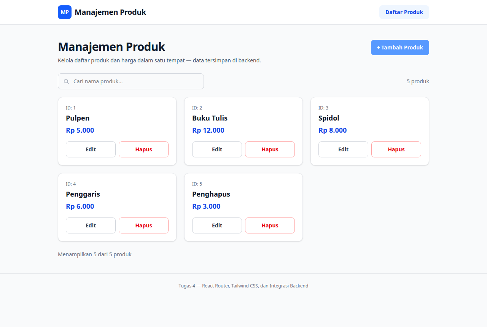
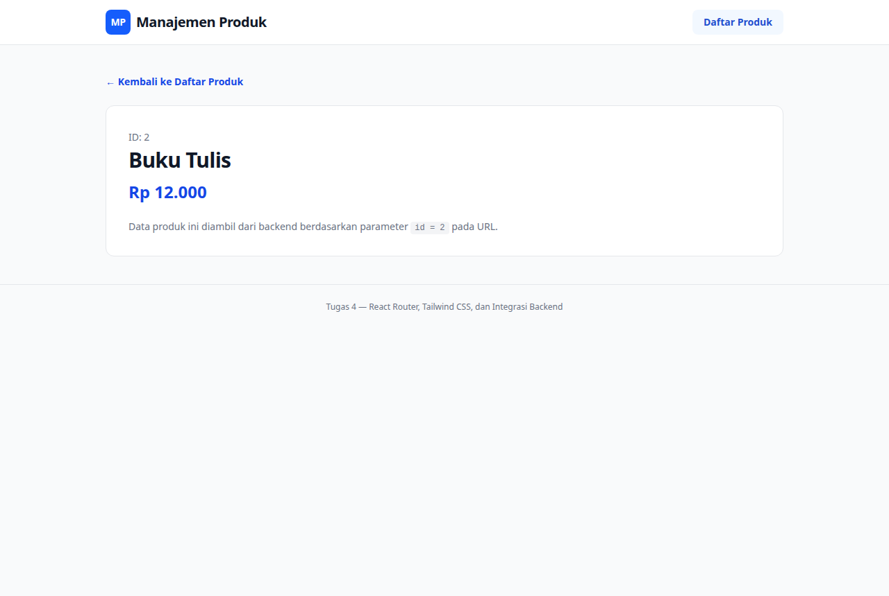
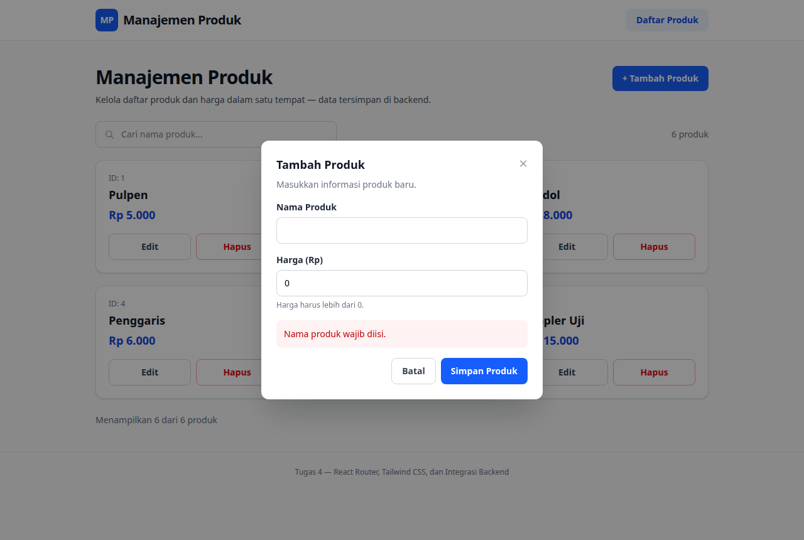
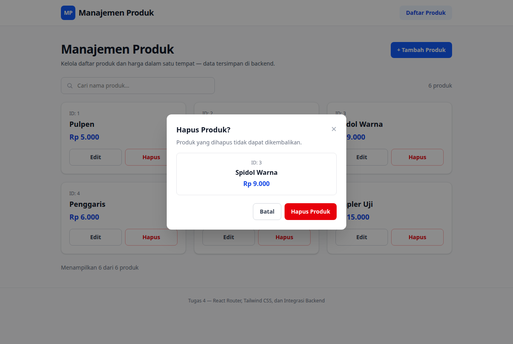
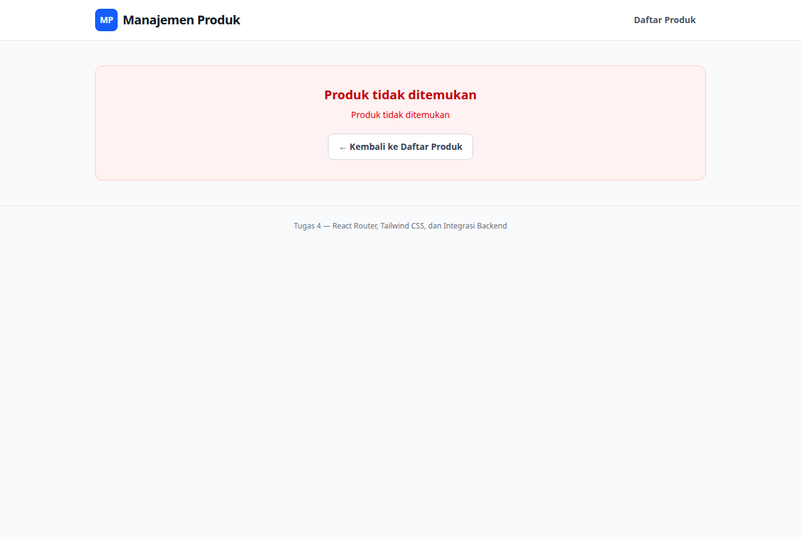
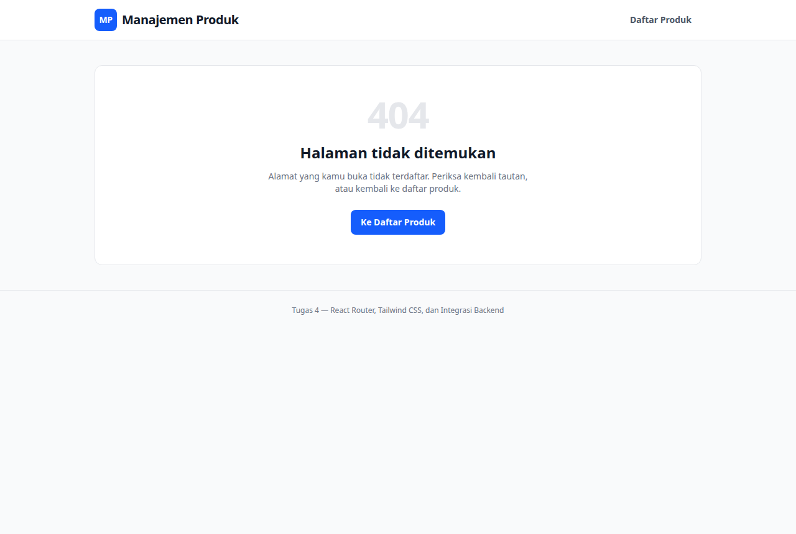
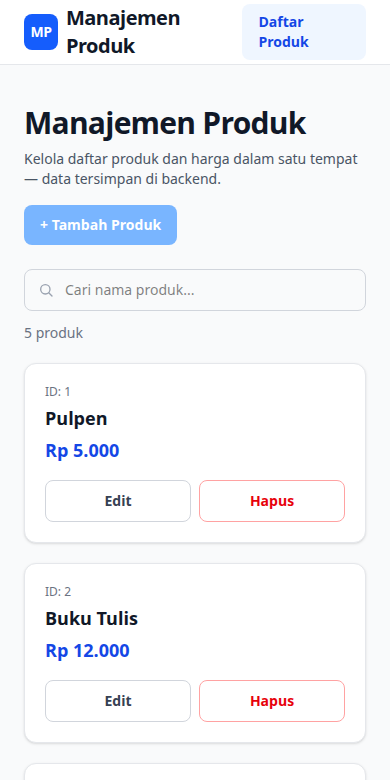

# Bukti Pengujian Tugas 4

Pengujian dilakukan dengan Chrome (Playwright headless), frontend Vite di `localhost:5173`,
dan Product API Express + SQLite di `localhost:3000` (dihubungkan lewat proxy `/api`).
Data mengikuti hasil seed awal: 5 produk (Pulpen, Buku Tulis, Spidol, Penggaris, Penghapus).

## Ringkasan Skenario

| # | Skenario | Hasil yang diharapkan | Hasil aktual |
|---|---|---|---|
| 1 | Buka halaman utama | Daftar 5 produk diambil dari API | ✅ 5 kartu produk tampil |
| 2 | Cari "pen" | Hanya Pulpen, Penggaris, Penghapus tampil | ✅ 3 kartu sesuai |
| 3 | Klik nama produk | Navigasi SPA ke `/products/2`, detail Buku Tulis | ✅ URL dan judul sesuai |
| 4 | Link "Kembali ke Daftar Produk" | Kembali ke `/` tanpa memuat ulang dokumen | ✅ |
| 5 | Tambah produk (Stapler Uji, 15000) | POST ke API, halaman detail produk baru terbuka | ✅ `/products/6` |
| 5b | Nama berisi spasi & harga 0 | Form menolak, pesan validasi tampil sebelum POST | ✅ "Nama produk wajib diisi." |
| 6 | Edit Spidol jadi "Spidol Warna" (9000) | PUT tersimpan, daftar menampilkan nilai baru | ✅ terverifikasi di API |
| 7 | Hapus "Spidol Warna" | Konfirmasi, DELETE, produk hilang dari daftar | ✅ |
| 8 | Buka `/products/999` | Pesan "Produk tidak ditemukan" + tautan kembali | ✅ |
| 9 | Buka URL tidak terdaftar `/halaman-ngawur` | Halaman 404 + tautan ke daftar produk | ✅ |
| 10 | Viewport 390px | Tampilan mobile tanpa horizontal scroll | ✅ grid menyusut jadi 1 kolom |
| 11 | Reload setelah tambah | Data tetap ada (tersimpan di backend, bukan state) | ✅ "Stapler Uji" masih tampil |
| 12 | Navigasi antar halaman | SPA: window state tidak hilang, tidak ada full reload | ✅ marker tetap "alive" |

## Bukti Screenshot

| Skenario | File |
|---|---|
| Daftar produk |  |
| Detail produk (`/products/2`) |  |
| Validasi form |  |
| Dialog hapus |  |
| Produk tidak ditemukan |  |
| Halaman 404 |  |
| Mobile 390px |  |

## Menjalankan Ulang Pengujian

```bash
# terminal 1 — backend
cd server
npm install
npx prisma migrate dev      # buat tabel (sekali saja)
npx tsx prisma/seed.js      # reset data ke 5 produk awal
npx tsx app.js              # API di http://localhost:3000

# terminal 2 — frontend
npm install
npm run dev                 # frontend di http://localhost:5173
```

`npm run build` juga berhasil (vite production build, tanpa error).
